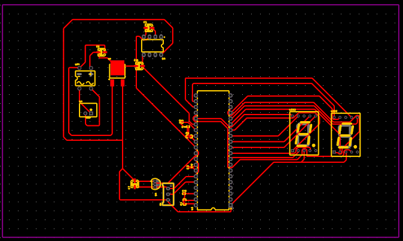

# LM35 + ICL7107 Digital Thermometer

An analog, two-digit temperature display designed for the IE2044 Systems Modelling and Prototyping assignment at SLIIT. An LM35 produces a voltage proportional to temperature; an ICL7107 converts the signal and drives two seven-segment displays. The work includes Proteus simulation, an EasyEDA Pro PCB layout, and a breadboard prototype.



## At a glance

| Item | Design |
| --- | --- |
| Intended range | 0–99 °C |
| Sensor | LM35, nominal 10 mV/°C |
| Conversion and display driver | ICL7107, DIP-40 |
| Display | Two seven-segment digits |
| Supply | +5 V and −5 V rails for the converter |
| Tools | Proteus and EasyEDA Pro |

## How it works

```text
Temperature → LM35 → input scaling → ICL7107 → seven-segment display
                              ↑             ↑
                        calibration     ±5 V supply
```

The LM35 nominally produces `Vout = temperature (°C) × 10 mV`. For example, 25 °C corresponds to 250 mV. The ICL7107 reference and input scaling must be calibrated together so the displayed number corresponds to degrees Celsius. The assignment specifies a 100 mV reference; the submitted report also describes a 10:1 input divider. **Do not assume that setting the reference alone makes the display accurate.** Verify the actual transfer function and component values against the ICL7107 datasheet and measured circuit before fabrication or relying on a reading.

## Project evidence

| Artifact | What it shows |
| --- | --- |
| [Final report](docs/IE2044_Assignment_Group_08.pdf) | Design method, component selection, calculations, simulation, PCB views, and discussion |
| [Proteus circuit screenshot](docs/images/simulation-2.png) | Simulated circuit and display |
| [EasyEDA schematic screenshot](docs/images/simulation-results-1.png) | Schematic captured in the report |
| [PCB layout](docs/images/pcb-design-1.png) | Routed board view |
| [PCB 3D view](docs/images/pcb-design-4.png) | Component placement and display alignment |
| [Breadboard prototype](docs/images/prototype-1.jpg) | Physical test setup pictured in the report |

The images were extracted from the submitted report. See [design notes](docs/design-notes.md) and [verification status](docs/verification.md) for details.

## Reproducing the design

1. Review the [report](docs/IE2044_Assignment_Group_08.pdf), screenshots, and the LM35 and ICL7107 datasheets.
2. Recreate the schematic in Proteus or another circuit tool. Check the ICL7107 display type, oscillator, integrator, auto-zero circuit, reference, and input scaling against the datasheet.
3. Simulate test inputs corresponding to 0, 10, 25, 50, 75, and 99 °C. Record the **actual** displayed values and reference voltage.
4. Recreate or revise the PCB in EasyEDA Pro. Check footprints, clearances, power routing, decoupling, and analog return paths before ordering.
5. Before inserting the ICL7107, measure both supply rails. Then calibrate and test the assembled circuit with a known temperature reference.

Native Proteus and EasyEDA project files were not available among the supplied materials, so the screenshots cannot be edited as source designs or used to generate manufacturing files. Gerbers and a bill of materials are likewise not included. The repository is a documented project record and starting point for recreating the design.

## Contributors

- K. G. U. K. Iranthaka — IT24103475
- P. K. S. Sanilka — IT24103564

Group 08, IE2044, 2026. Contributions are listed as in the submitted report; individual responsibilities were not documented.

## Project status

Simulation, PCB layout, and a breadboard photo are documented in the report. Quantitative hardware accuracy, a fabricated PCB, and a repeatable measured test log are not documented in the supplied files. See [verification status](docs/verification.md).
